# easyEmbodiedDeploy

**从示教采集到 VLA 真机部署，一个本地 Web 工作台。**

面向 **Piper 双臂 + Orbbec 三路相机**，串起数据采集、轨迹编辑、数据转换、相机标定和 **π0.5（PI05）** 训练部署。支持 **LeRobot / PyTorch** 与 **OpenPI / JAX** 两套后端，也可以把固定关键点与多个 VLA 模型编排成自定义工作流。

[快速开始](#快速开始) · [模块与用法](#模块与用法) · [界面预览](#界面预览) · [详细文档](#详细文档)

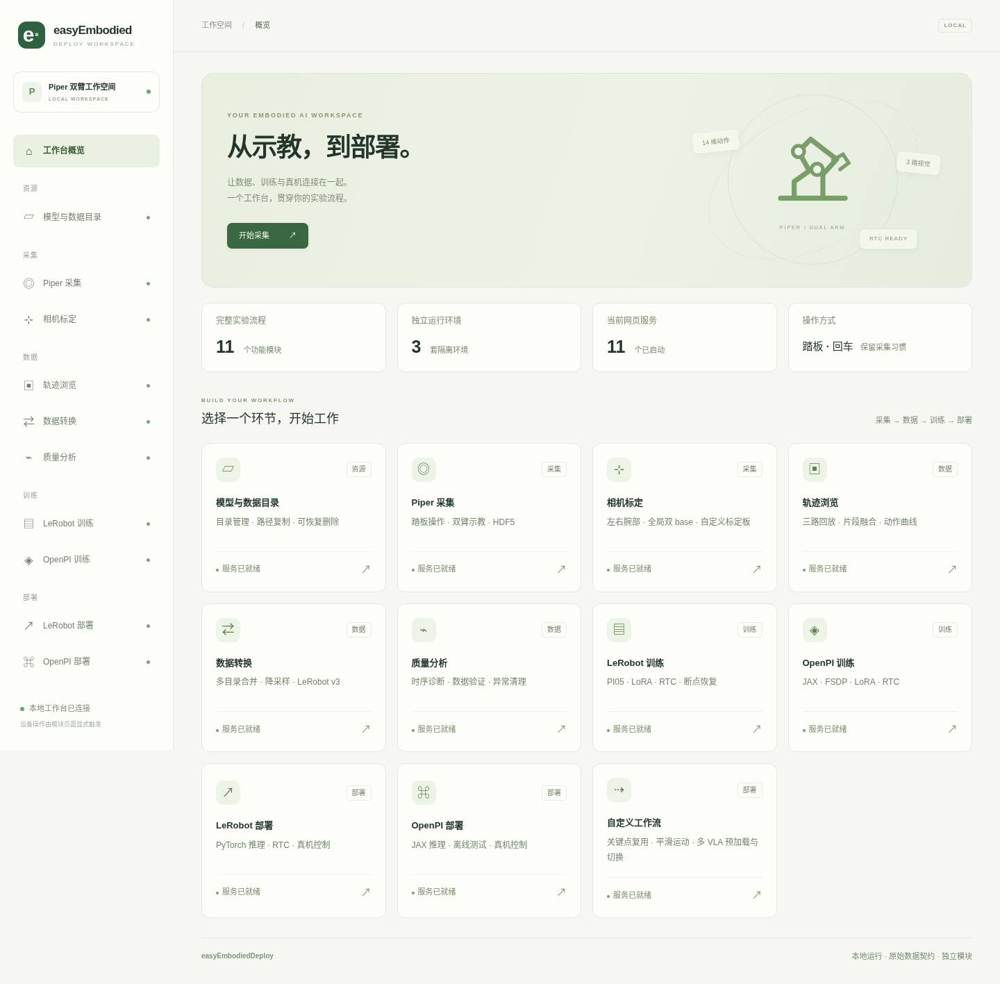

## 快速开始

在 Linux 上安装 [uv](https://docs.astral.sh/uv/getting-started/installation/)，然后执行：

```bash
git clone --recurse-submodules https://github.com/YiPan-ECLab/easyEmbodiedDeploy.git
cd easyEmbodiedDeploy

bash thirdParty/setup_envs.sh         # 采集、数据工具、LeRobot 训练与部署
# bash thirdParty/setup_openpi_env.sh # 使用 OpenPI 时再安装

python3 workbench.py
```

打开 **http://127.0.0.1:8088**，从左侧选择模块。已有环境只需执行最后一行；端口冲突时用 `python3 workbench.py --port 8090`。

工作台按需启动各模块的独立服务，打开页面不会自动连接机械臂或启动训练。首次使用的 GPU 驱动、相机权限、CAN 接口和环境配置见 [安装指南](thirdParty/README.md)。数据和模型放在 `datasets/`、`models/`，不随 Git 分发。

## 模块与用法

常用路线：**采集 → 浏览 / 部分融合 → 转换 → 质量检查 → 训练 → 部署或工作流**。使用相机坐标动作或深度选点时，先完成相应相机标定。

| 模块 | 主要功能 | 怎么用 |
| --- | --- | --- |
| [Piper 采集](scripts/PiperRecorder/README.md) | 四臂主从示教、三路实时预览、脚踏板采集、自定义起点 | 选起点 → 连接归位 → 输入指令 → 踏板 / 回车开始、结束、保存 |
| [相机标定](scripts/CameraCalibration/README.md) | 腕部手眼 / 全局相机外参、独立验证、双基座变换导出 | 选任务与标定板 → 多姿态采样 → 求解 → 新姿态验证 → 导出 |
| [轨迹浏览](scripts/PiperViewer/README.md) | 三路同步回放、关节曲线、逐帧检查、片段融合 | 打开 episode → 标记简单片段与抽帧倍率 → 预览 → 导出新 HDF5 |
| [数据转换](scripts/LerobotDataProcessor/README.md) | 多目录、多任务 HDF5 → LeRobot v3；关节与末端位姿动作 | 选输入目录、动作表示 → 检查输入 → 转换并自动复验 |
| [质量分析](scripts/DataAnalysis/README.md) | HDF5 / LeRobot 全量检查、异常定位、报告导出与清理 | 选数据类型和路径 → 全面检查 → 查看逐条结果 |
| [LeRobot 训练](scripts/LerobotTrainer/README.md) | PI05、LoRA / 直接权重微调、RTC 训练、单 / 多卡、断点续训 | 选数据集和基座 → 配置训练方式与 GPU → 验证 → 启动 |
| [OpenPI 训练](scripts/OpenpiTrainer/README.md) | JAX PI05、LoRA / 直接权重微调、RTC 训练、FSDP、断点续训 | 选数据集和基座 → 配置训练方式与 GPU → 验证 → 启动 |
| [LeRobot 部署](scripts/LerobotDeployer/README.md) | PyTorch 推理、同步 / RTC、硬件桥、运行诊断 | 选 checkpoint、动作模式和 policy Hz → 检查配置 → 启动部署 |
| [OpenPI 部署](scripts/OpenpiDeployer/README.md) | JAX 推理、同步 / RTC、预热、离线数据推理与真机部署 | 选 checkpoint、动作模式和 policy Hz → 配置输入 → 启动部署 |
| [自定义工作流](scripts/Workflow/README.md) | 共享关键点 / 模型库、步骤拖拽、多模型预加载、平滑衔接 | 录点 / 选点 → 添加关键点、VLA、夹爪或等待步骤 → 保存 → 执行 |
| 模型与数据目录 | 浏览、重命名、复制路径、回收站与恢复 | 在工作台管理 `models/` 和 `datasets/`，复制路径供其他模块使用 |

**自定义起点：**在采集设置中导入工作流共享点，或读取从臂姿态，核对后保存。每条采集前后返回该点，各侧主从臂目标一致。

**混合工作流：**关键点和模型跨流程共享、反复引用。用从臂机身按钮拖动录点，也可手动输入、从 HDF5 提取或通过深度相机选点。固定点运动期间可后台加载 VLA，执行前按需平滑回零。

**部分融合：**简单片段抽稀，复杂片段保留密度，另存新文件并标记 `fps: mixed`。训练按新序列读取 chunk，部署独立设置 **policy Hz**；快慢能力是否能被学到，由训练实验验证。

## 界面预览

以下均为 **2026-10-15 当前版本的浏览器截图**。采集、标定和部署页面展示未连接设备的配置界面；轨迹浏览使用已有录制，工作流展示内置模拟编排示例。点击图片可查看原图。

<details open>
<summary><strong>自定义工作流 · 关键点与 VLA 混合编排</strong></summary>

[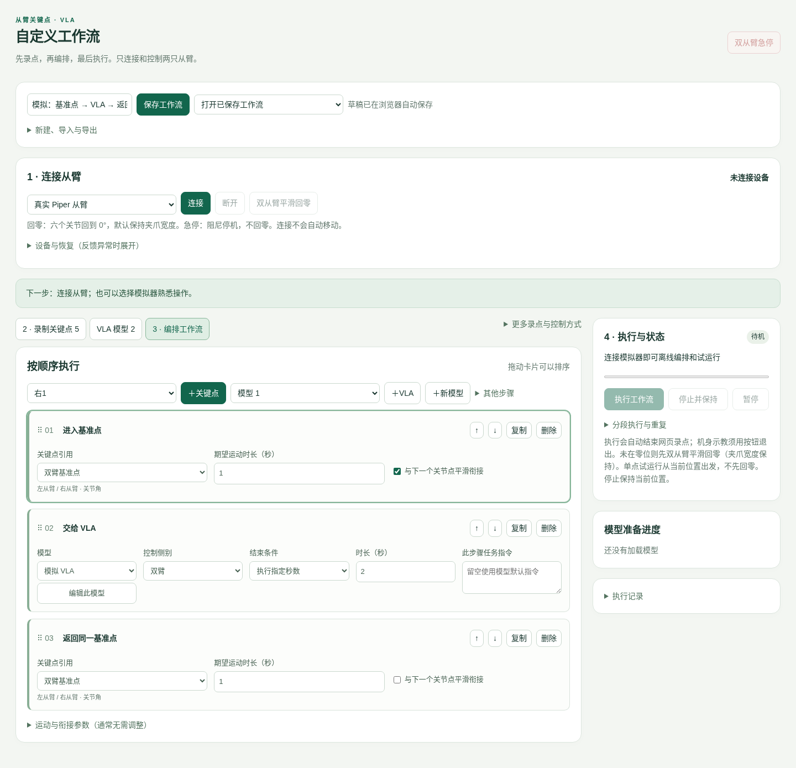](docs/images/modules/workflow.png)

</details>

<details>
<summary><strong>采集与标定 · 包含自定义采集起点</strong></summary>

| Piper 采集 | 相机标定 |
| --- | --- |
| [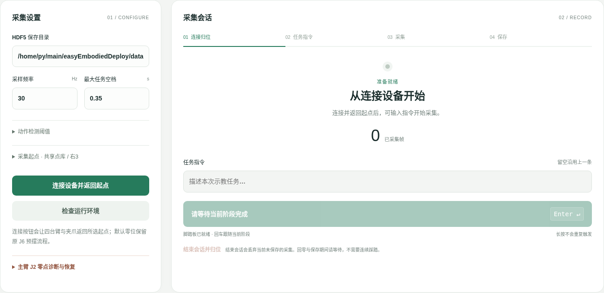](docs/images/modules/recorder.png) | [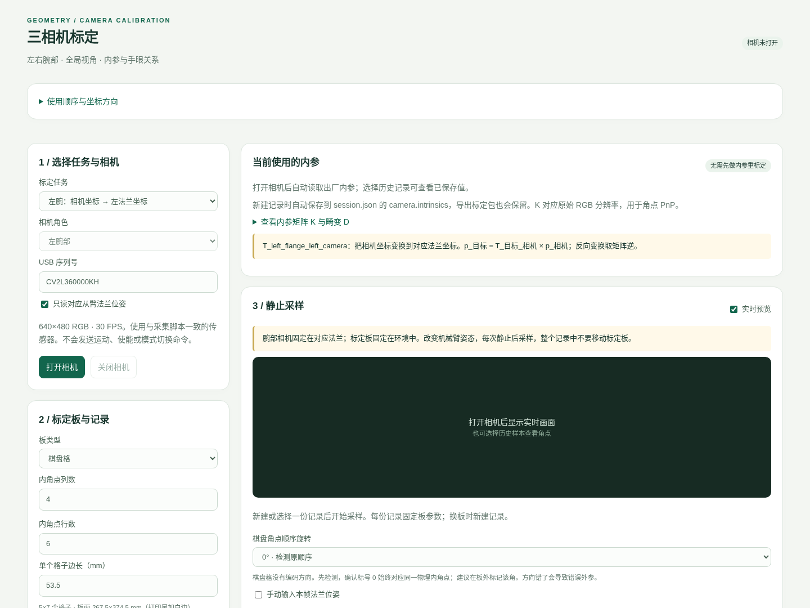](docs/images/modules/calibration.png) |

自定义采集起点：导入共享点、读取从臂、核对两侧目标后保存。

[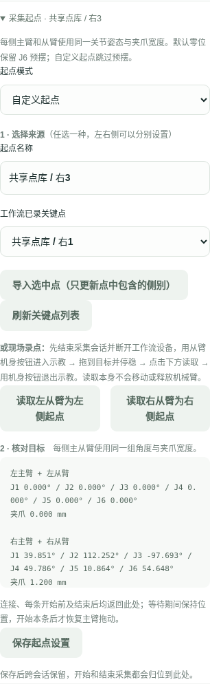](docs/images/modules/recorder-start-point.png)

</details>

<details>
<summary><strong>数据工具 · 轨迹浏览、部分融合、转换与质量分析</strong></summary>

[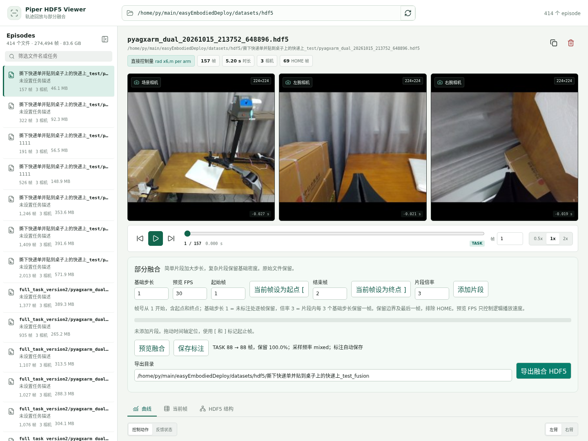](docs/images/modules/viewer.png)

| 数据转换 | 质量分析 |
| --- | --- |
| [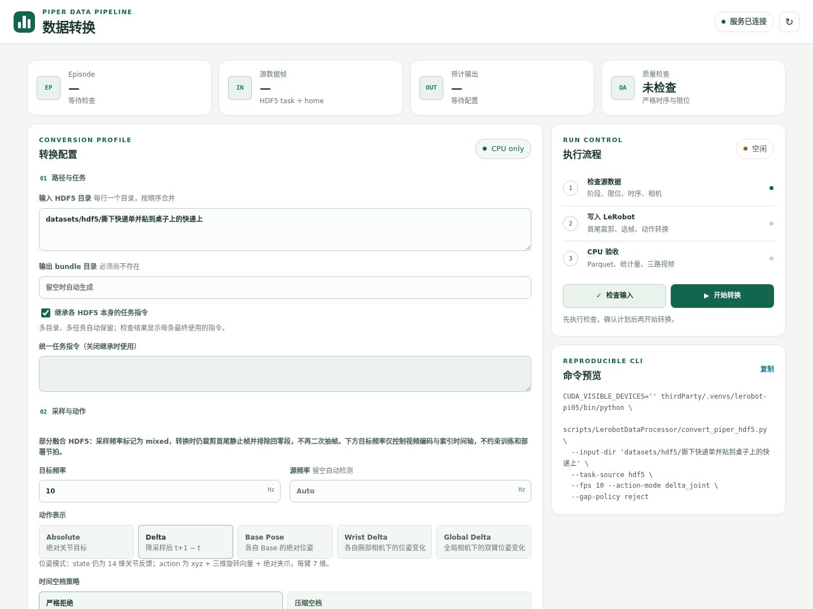](docs/images/modules/processor.png) | [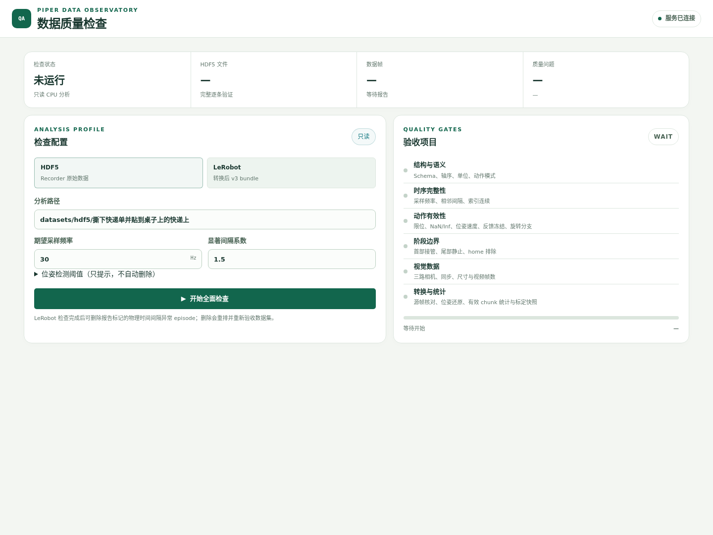](docs/images/modules/analysis.png) |

</details>

<details>
<summary><strong>训练与部署 · LeRobot / PyTorch、OpenPI / JAX</strong></summary>

| LeRobot | OpenPI |
| --- | --- |
| [](docs/images/modules/lerobot-trainer.png) | [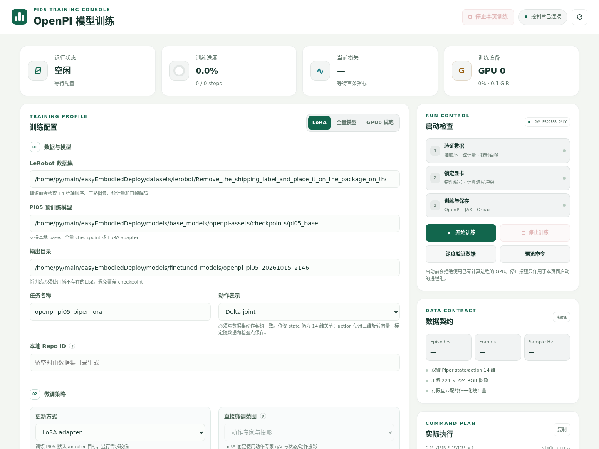](docs/images/modules/openpi-trainer.png) |
| [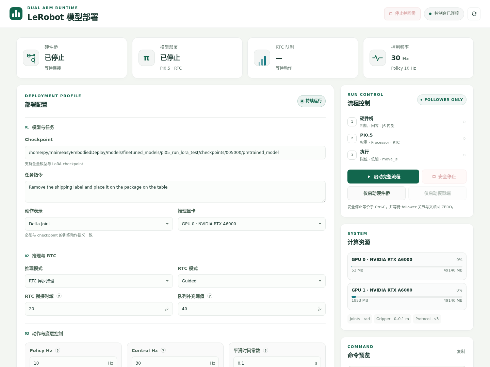](docs/images/modules/lerobot-deployer.png) | [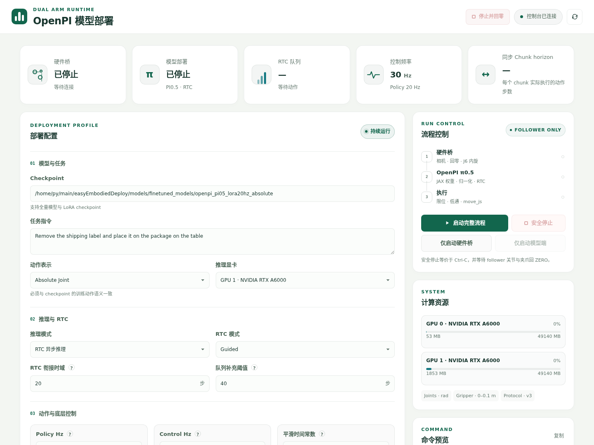](docs/images/modules/openpi-deployer.png) |

</details>

<details>
<summary><strong>模型与数据目录 · 文件浏览与回收站</strong></summary>

[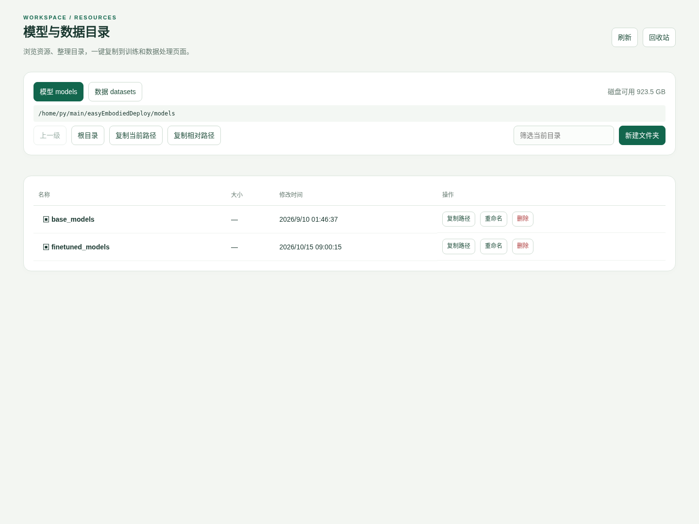](docs/images/modules/files.png)

</details>

## 详细文档

各模块的操作步骤见上表链接；进一步了解：

[安装与迁移](thirdParty/README.md) · [标定流程](scripts/CameraCalibration/README.md) · [关节与位姿数据链路](docs/POSE_ACTION_DATAFLOW.md) · [多硬件 / 多 Policy 扩展设计](docs/MULTI_HARDWARE_MULTI_POLICY_DESIGN.md)

转换、训练、部署应使用同一动作语义。开发检查：安装所需环境后运行 `python3 tests/run_checks.py`。
