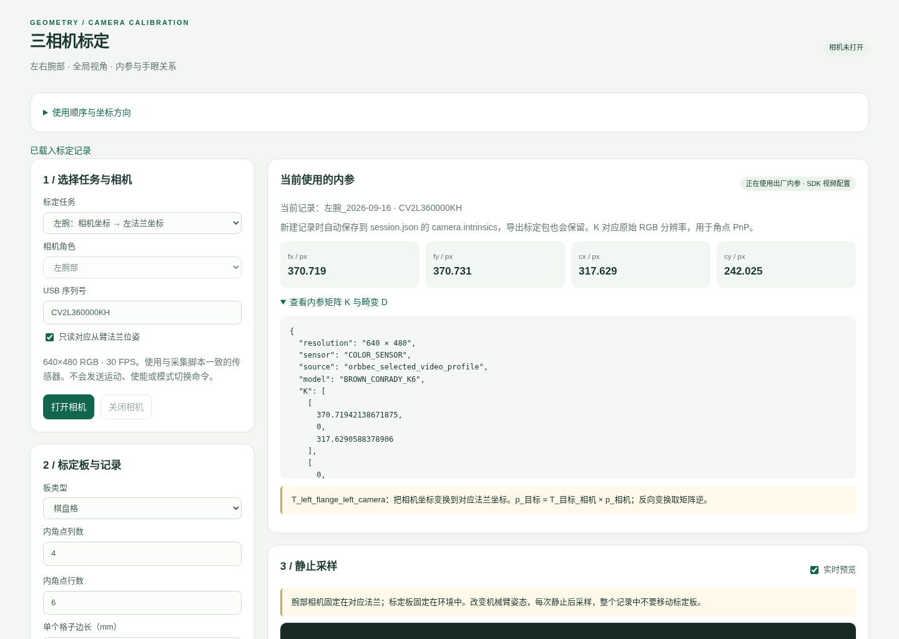

# 统一界面与出厂内参验收

日期：2026-09-16；基线：`f4c8099`。本轮仅修改前端、测试和文档。位姿转换、训练和部署按最新要求暂停；简明方案见 [位姿链路](POSE_ACTION_DATAFLOW.md)，逐模块改动见 [改动清单](MODULE_CHANGES.md#2026-09-16统一界面出厂内参与简化位姿说明)。




## 软件和相机验证

| 项目 | 结果 |
| --- | --- |
| 原有 CPU 回归 | 117 项通过，覆盖采集、转换、分析、两套训练 / 部署、HTTP 边界、目录和标定 |
| HTTP 数据链路 | Viewer 读取、HDF5 分析、真实 LeRobot 转换、转换后分析、两个训练校验接口通过 |
| 原浏览器流程 | 十模块加载无 JS 异常；脚踏板长按去重、保存、丢弃通过 |
| 目录管理 | 新建、重命名、复制路径、移入回收站、恢复、永久删除通过；只操作测试 UUID 目录 |
| 标定页面 | 自定义板参数、合成真值求解 / 导出、内参在求解前显示、取消历史记录后清空旧数据通过 |
| 统一样式 | 十模块在 1440、768、390 px 下展开高级控件，无页面横向溢出；训练预设切换、命令预览和标定矩阵方向切换通过 |
| 三台真实相机 | 全局、左腕、右腕均读取 640×480 RGB 和实际选中 profile 的出厂 K / D；新建记录后重新加载，内参逐项一致 |
| 左右从臂只读位姿 | 均通过原 SDK `connect → get_flange_pose → disconnect` 读取；测试未增加仓库硬件逻辑 |
| 实际内参的浏览器展示 | 读取已有真实左腕记录，页面 K / D 与保存值完全一致，来源明确显示“正在使用出厂内参”，无需重标定记录 |
| OpenPI GPU 推理 | 真实 checkpoint `openpi_pi05_10hz_full_trainedrtc_absolute/20000`，100 步离线 trained RTC，退出码 0；中位约 241.35 ms，运行饿死 0 |
| 指标页面 | 真实上述 JSONL 与 summary 的延迟、计数、曲线、路径均显示；离线没有硬件发送频率，正确显示“—” |
| 语法检查 | Python 编译、全部浏览器 JavaScript 解析、启动脚本 Bash 解析、git diff 空白检查通过 |
| 变更边界 | 七个原模块的 DOM ID 保持一致；四个训练 / 部署 app.js 仅修改图表颜色；`src/`、SDK、采集器及所有脚本 Python 后端与基线一致 |

相机身份与 profile：

| 角色 | 序列号 | 内参来源 |
| --- | --- | --- |
| 全局 | CP2AB530005P | COLOR_SENSOR / BROWN_CONRADY_K6 / 640×480 |
| 左腕 | CV2L360000KH | COLOR_SENSOR / BROWN_CONRADY_K6 / 640×480 |
| 右腕 | CV2L3600003K | COLOR_SENSOR / BROWN_CONRADY_K6 / 640×480 |

右臂首次只读采样紧接 SDK 连接，接收线程尚未提供位姿；按正常操作间隔等待 1 秒后，三相机与左右位姿复测均通过。未为此修改 SDK、增加模式切换或改动反馈逻辑。

GPU 离线动作触发了原有关节限幅，计数 100；这些动作没有发往机械臂。此次验证推理、统计记录与界面，不证明模型能完成实物任务。

## 退出示教后的真机补测

此前左从臂 `piper-lo` 在原 60 秒回零流程中超时，当时 SDK 返回 `TEACHING_MODE / START_RECORDING`。操作者退出示教后，仍使用原硬件实现复测。仓库没有增加自动退出示教、反馈门槛或其他硬件控制逻辑；采集器 `robot.py` 与 `e4145bf` 完全一致。

测试使用独立工作台 `127.0.0.1:8098` 和硬件桥 `6107`。双从臂及夹爪初始回零、J6 −45° / +45° 预定位、三路 224×224 RGB 观测均通过。发送与当前反馈相同的保持目标后，原控制循环完成 36 次发送，实测 **30.001 Hz**；随后按原退出流程双从臂与夹爪回零，硬件桥退出码 **0**。

| 补测项目 | 结果 |
| --- | --- |
| LeRobot 网页完整部署 | 使用此前真实数据训练生成的 `000001/pretrained_model`，真实三路相机、trained RTC、3 个有效动作、dry-run；模型与硬件桥均退出 0，双从臂和夹爪归零 |
| OpenPI 网页完整部署 | 使用同一轮实训生成的 `openpi-trainer/0`，真实三路相机、trained RTC、3 个有效动作、dry-run；模型与硬件桥均退出 0，双从臂和夹爪归零 |
| 实际部署指标 | OpenPI 推理中位数 148.83 ms，运行饿死 0；三个 action tick 均带推理统计和累计计数；JSONL、落盘 summary、HTTP 与网页一致；1440 / 768 / 390 px 均显示正常 |
| 原桥实际动作下发 | 左右 J6 分别向零位请求 +2° / −2°，约 1.5 秒内实测 +1.646° / −1.373°，目标误差 −0.354° / +0.627°；原 30 Hz 平滑控制正常发送，发回初始目标后按原退出流程完成回零 |
| 采集页真机 Enter 流程 | 四臂 / 四夹爪连接和初始回零、J6 预定位、等待真人动作、Enter 长按不跨阶段结束、再次 Enter 结束并回零、空 task 拒绝保存、结束会话通过；退出码 0，未生成伪示教文件 |
| 十模块页面复核 | 展开高级配置后，桌面 / 平板 / 手机布局和交互全部通过，无页面 JS 异常；修正测试脚本未等待模块冷启动完成的问题，产品接口未改动 |
| 最终归位 | 原采集流程确认两组主从臂及四夹爪归零；会话结束后只读 SDK 复核，两个从臂均为 NORMAL / CAN_CTRL，六关节反馈全部为 0 |

两套模型测试均使用 policy 2 Hz、control 30 Hz、max_steps=3。LeRobot 预填充等待 2 tick，之后运行饿死 0；OpenPI 预填充及运行饿死均为 0。两者 `move_js.cycles_sent=0`，因为模型预测使用 dry-run；OpenPI 页面此时正确显示 **0.00 Hz**。实际下发与关节响应由单独的保持 / J6 小步测试验证。这些短测不代表模型的实物任务成功率。

小步测试先请求过 0.5°，约 1.5 秒内两侧 J6 反馈未发生变化，因而该项精度断言没有通过；随后上述 2° 请求确认了实际运动响应。保留此现象，不把它解释为已确定的 SDK bug；保持原 SDK 和控制参数，未加入补偿。**不能据此承诺亚度级跟踪精度**；2° 测试的剩余误差如表中所列。

采集退出后，主臂已按原流程恢复拖动状态，另开的只读连接未取得主臂关节消息；主臂归零结论来自原采集器在恢复拖动前的反馈检查与完成日志，没有为取得消息额外切换模式。

补测结束后，测试工作台、十个模块服务及其模型 / 硬件子进程全部退出；8088、8098、6107 均无监听，可由操作者自行启动工作台验收。

真实手眼外参的精度仍需要按 [标定说明](CAMERA_CALIBRATION.md) 固定板面，采集多姿态并用独立姿态验收；合成真值测试不能代替这一项。

## 本机证据与复现

- CPU 日志：`/tmp/eed-style-regression/`。
- 十模块桌面 / 手机截图：`/tmp/easy-theme-browser/`。
- 目录、标定和 OpenPI 指标截图：`/tmp/eed-final-resources/`。
- 真实相机读取与持久化：`/tmp/eed-real-intrinsics-result.json`。
- 真实内参展示截图：`/tmp/eed-real-intrinsics-browser.png`。
- 桥接保持补测：`/tmp/eed-bridge-regression-log.json`；此前示教状态的只读诊断：`/tmp/eed-arm-readonly.log`。
- GPU 诊断：`outputs/openpi_deployer/20260916-214628-63db6044.jsonl` 及同名 `.summary.json`。
- 退出示教后的完整补测产物：`outputs/hardware-resume-20260916/`，包含两套部署配置 / 日志 / 诊断 / 截图、采集会话结果、保持和 J6 小步测试、最终从臂只读反馈，以及 `harness/` 下的临时测试脚本。此目录由 Git 忽略，不上传数据或权重。

本轮数据转换、两套真实 1 步训练以及 checkpoint 衔接的记录见 [统一 Web 验收](WEB_ACCEPTANCE.md)。117 项软件回归已在上一轮通过；本次针对示教状态解除后的硬件项和新产生的真实指标补测，没有重复训练或修改训练逻辑。

需操作者完成的实物验收仍为：真实踏板录制 / 保存一条人工示教、固定板面后采集多姿态并独立验证外参精度，以及充分训练模型的实际任务效果。位姿转换、训练和执行仍暂停。

在独立终端启动 `python3 workbench.py --port 8098` 后：

```bash
python3 tests/run_checks.py
thirdParty/.venvs/lerobot-pi05/bin/python tests/http_smoke.py --url http://127.0.0.1:8098
uv run --no-project --with playwright python tests/browser_smoke.py --url http://127.0.0.1:8098
uv run --no-project --with playwright python tests/browser_resources.py --url http://127.0.0.1:8098
uv run --no-project --with playwright python tests/browser_theme.py --url http://127.0.0.1:8098
```

可加 `--browser /path/to/chromium` 使用已安装浏览器。这些自动回归不启动硬件或训练；真机验证另行显式执行。
