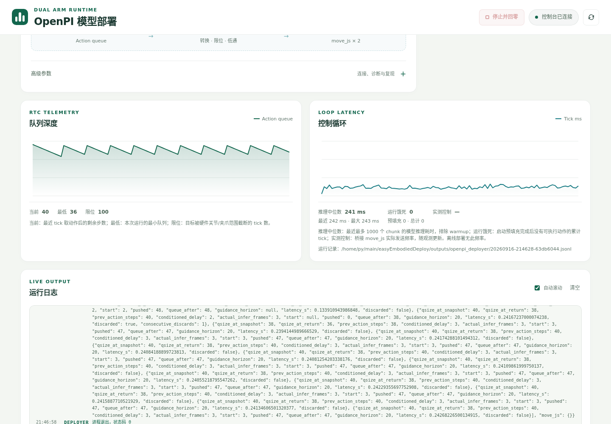

# 统一界面与出厂内参验收

日期：2026-09-16；基线：`f4c8099`。本轮仅修改前端、测试和文档。位姿转换、训练和部署按最新要求暂停；简明方案见 [位姿链路](POSE_ACTION_DATAFLOW.md)，逐模块改动见 [改动清单](MODULE_CHANGES.md#2026-09-16统一界面出厂内参与简化位姿说明)。




## 软件和相机验证

| 项目 | 结果 |
| --- | --- |
| 原有 CPU 回归 | 117 项通过，覆盖采集、转换、分析、两套训练 / 部署、HTTP 边界、目录和标定 |
| HTTP 数据链路 | Viewer 读取、HDF5 分析、真实 LeRobot 转换、转换后分析、两个训练校验接口通过 |
| 原浏览器流程 | 十模块加载无 JS 异常；脚踏板长按去重、保存、丢弃通过 |
| 目录管理 | 新建、重命名、复制路径、移入回收站、恢复、永久删除通过；只操作测试 UUID 目录 |
| 标定页面 | 自定义板参数、合成真值求解 / 导出、内参在求解前显示、取消历史记录后清空旧数据通过 |
| 统一样式 | 十模块在 1440、768、390 px 下展开高级控件，无页面横向溢出；训练预设切换、命令预览和标定矩阵方向切换通过 |
| 三台真实相机 | 全局、左腕、右腕均读取 640×480 RGB 和实际选中 profile 的出厂 K / D；新建记录后重新加载，内参逐项一致 |
| 左右从臂只读位姿 | 均通过原 SDK `connect → get_flange_pose → disconnect` 读取；测试未增加仓库硬件逻辑 |
| 实际内参的浏览器展示 | 读取已有真实左腕记录，页面 K / D 与保存值完全一致，来源明确显示“正在使用出厂内参”，无需重标定记录 |
| OpenPI GPU 推理 | 真实 checkpoint `openpi_pi05_10hz_full_trainedrtc_absolute/20000`，100 步离线 trained RTC，退出码 0；中位约 241.35 ms，运行饿死 0 |
| 指标页面 | 真实上述 JSONL 与 summary 的延迟、计数、曲线、路径均显示；离线没有硬件发送频率，正确显示“—” |
| 语法检查 | Python 编译、全部浏览器 JavaScript 解析、启动脚本 Bash 解析、git diff 空白检查通过 |
| 变更边界 | 七个原模块的 DOM ID 保持一致；四个训练 / 部署 app.js 仅修改图表颜色；`src/`、SDK、采集器及所有脚本 Python 后端与基线一致 |

相机身份与 profile：

| 角色 | 序列号 | 内参来源 |
| --- | --- | --- |
| 全局 | CP2AB530005P | COLOR_SENSOR / BROWN_CONRADY_K6 / 640×480 |
| 左腕 | CV2L360000KH | COLOR_SENSOR / BROWN_CONRADY_K6 / 640×480 |
| 右腕 | CV2L3600003K | COLOR_SENSOR / BROWN_CONRADY_K6 / 640×480 |

右臂首次只读采样紧接 SDK 连接，接收线程尚未提供位姿；按正常操作间隔等待 1 秒后，三相机与左右位姿复测均通过。未为此修改 SDK、增加模式切换或改动反馈逻辑。

GPU 离线动作触发了原有关节限幅，计数 100；这些动作没有发往机械臂。此次验证推理、统计记录与界面，不证明模型能完成实物任务。

## 真机桥接状态

本次通过独立测试工作台启动**未改动的原硬件桥**，计划在 6107 端口只发送一个与当前状态相同的保持目标。

启动中右从臂及夹爪完成回零；左从臂 `piper-lo` 在原 60 秒回零流程中超时，尚未进入保持目标阶段。之后只读 SDK 确认：

- 左：`ctrl_mode=TEACHING_MODE`、`teach_status=START_RECORDING`，六关节使能，`arm_status=NORMAL`。
- 右：`ctrl_mode=CAN_CTRL`、`teach_status=STOP_RECORDING`，六关节反馈为零。

该次桥接已停止，未发送模型预测动作。**本次不能将双臂部署 / 完整回零标记为通过，也不能声称左臂已归位。** 已请操作者按原方式退出左臂示教状态，之后才能复测。仓库没有增加自动退出示教或其他硬件控制逻辑。

真实手眼外参的精度仍需要按 [标定说明](CAMERA_CALIBRATION.md) 固定板面，采集多姿态并用独立姿态验收；合成真值测试不能代替这一项。

## 本机证据与复现

- CPU 日志：`/tmp/eed-style-regression/`。
- 十模块桌面 / 手机截图：`/tmp/easy-theme-browser/`。
- 目录、标定和 OpenPI 指标截图：`/tmp/eed-final-resources/`。
- 真实相机读取与持久化：`/tmp/eed-real-intrinsics-result.json`。
- 真实内参展示截图：`/tmp/eed-real-intrinsics-browser.png`。
- 原桥接尝试：`/tmp/eed-bridge-regression-log.json`、`/tmp/eed-arm-readonly.log`。
- GPU 诊断：`outputs/openpi_deployer/20260916-214628-63db6044.jsonl` 及同名 `.summary.json`。

在独立终端启动 `python3 workbench.py --port 8098` 后：

```bash
python3 tests/run_checks.py
thirdParty/.venvs/lerobot-pi05/bin/python tests/http_smoke.py --url http://127.0.0.1:8098
uv run --no-project --with playwright python tests/browser_smoke.py --url http://127.0.0.1:8098
uv run --no-project --with playwright python tests/browser_resources.py --url http://127.0.0.1:8098
uv run --no-project --with playwright python tests/browser_theme.py --url http://127.0.0.1:8098
```

可加 `--browser /path/to/chromium` 使用已安装浏览器。这些自动回归不启动硬件或训练；真机验证另行显式执行。
